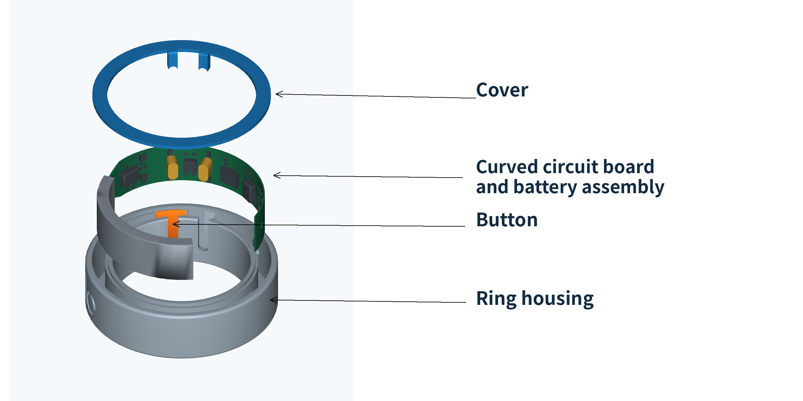

# OpenZilo Hardware

[简体中文](README.zh-CN.md)

Mechanical assembly models and assembly guides for the OpenZilo ring.

Includes **9 STEP assembly models** and an **8-step assembly guide** for inspecting the mechanical structure, modifying the design, and assembling the ring. For the Python SDK and BLE protocol documentation, see the [OpenZilo main repository](https://github.com/ziloai/openzilo).

[Download models](#download-models) · [Assembly guide](docs/assembly.en.md)



## Download models

| Model ID | STEP assembly file | File size |
| --- | --- | --- |
| 6 | [6_asm.stp](models/6_asm.stp) | 1.73 MB |
| 7 | [7_asm.stp](models/7_asm.stp) | 1.36 MB |
| 8 | [8_asm.stp](models/8_asm.stp) | 1.83 MB |
| 9 | [9_asm.stp](models/9_asm.stp) | 1.76 MB |
| 10 | [10_asm.stp](models/10_asm.stp) | 1.79 MB |
| 11 | [11_asm.stp](models/11_asm.stp) | 1.44 MB |
| 12 | [12_asm.stp](models/12_asm.stp) | 1.72 MB |
| 13 | [13_asm.stp](models/13_asm.stp) | 1.89 MB |
| 14 | [14_asm.stp](models/14_asm.stp) | 1.46 MB |

## Model contents and use

- Format: STEP (`.stp`), with AP214 declared in the file header.
- Length unit: millimeters (mm), as defined in each STEP file.
- Each assembly lists a ring housing (`*_ring`), cover (`*_cover`), and button (`button`).
- Original filenames and model data are preserved.

Import a STEP file into CAD software that supports the format to inspect the assembly or edit the model. Before manufacturing, check the parts and assembly relationships in your CAD software, then export the individual parts in the required format.

## Assembly guide

[Read the assembly guide](docs/assembly.en.md).

1. Identify the parts.
2. Install the button vertically.
3. Install the circuit board with the battery on the left, following the orientation shown in the diagram.
4. Fully seat both posts and protect the board components.
5. Check button movement and return before applying adhesive.
6. Apply adhesive around the ledge at the top of the housing. Check that both microphone ports and the button are free of adhesive and blockages.
7. Align the cover and press it gently into place.
8. Press around the edge, then inspect the seam and button movement.

Refer to the diagrams in the full guide for orientation, where to apply pressure, and adhesive placement.

## Repository layout

```text
OpenZilo-Hardware/
├── README.md               # English
├── README.zh-CN.md          # Simplified Chinese
├── LICENSE                 # Hardware: CERN-OHL-W-2.0
├── LICENSES/
│   └── MPL-2.0.txt          # Documentation: MPL-2.0
├── models/
│   └── 6_asm.stp … 14_asm.stp
└── docs/
    ├── assembly.md          # Chinese assembly guide
    ├── assembly.en.md       # English assembly guide
    └── assets/              # Assembly and detail images in both languages
```

## License

This repository follows the OpenZilo main project's licensing:

- Hardware design files in `models/` use [CERN-OHL-W-2.0](LICENSE).
- Documentation, including the READMEs, assembly guides, and illustrations, uses [MPL-2.0](LICENSES/MPL-2.0.txt).
- The OpenZilo name and marks belong to their respective owners.
