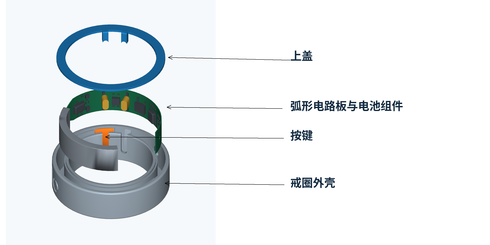

# OpenZilo Hardware

[English](README.md)

OpenZilo 戒指的机械装配模型与图文组装指南。

本仓库提供 **9 个 STEP 装配模型**和 **8 步组装说明**，便于查看机械结构、修改设计和了解组装顺序。Python SDK 与 BLE 协议文档见 [OpenZilo 主仓库](https://github.com/ziloai/openzilo)。

[模型下载](#模型下载) · [中文组装指南](docs/assembly.md) · [English assembly guide](docs/assembly.en.md)



## 模型下载

| 模型编号 | STEP 装配文件 | 文件大小 |
| --- | --- | --- |
| 6 | [6_asm.stp](models/6_asm.stp) | 1.73 MB |
| 7 | [7_asm.stp](models/7_asm.stp) | 1.36 MB |
| 8 | [8_asm.stp](models/8_asm.stp) | 1.83 MB |
| 9 | [9_asm.stp](models/9_asm.stp) | 1.76 MB |
| 10 | [10_asm.stp](models/10_asm.stp) | 1.79 MB |
| 11 | [11_asm.stp](models/11_asm.stp) | 1.44 MB |
| 12 | [12_asm.stp](models/12_asm.stp) | 1.72 MB |
| 13 | [13_asm.stp](models/13_asm.stp) | 1.89 MB |
| 14 | [14_asm.stp](models/14_asm.stp) | 1.46 MB |

## 模型内容与使用

- 文件格式：STEP（`.stp`），文件头声明 AP214。
- 长度单位：毫米（mm），以 STEP 文件内的单位定义为准。
- 每个文件的装配结构列有戒圈（`*_ring`）、上盖（`*_cover`）与按键（`button`）。
- 原始文件名与模型数据保持不变。

将 STEP 文件导入支持该格式的 CAD 软件，查看装配结构或编辑模型。需要制造时，先在 CAD 软件中确认零件与装配关系，再导出所需零件文件。

## 组装指南

[中文组装指南](docs/assembly.md) · [English assembly guide](docs/assembly.en.md)。

1. 确认零件种类。
2. 将按键竖向装入。
3. 按示意图方向，将电池置于左侧并装入电路板。
4. 确认两根立柱到底，保护板上器件。
5. 点胶前检查按键按压与回弹。
6. 沿外壳上方环形平台点胶，复查两处 MIC 与按键无进胶、无堵塞。
7. 对位上盖，轻压合拢。
8. 沿周压合，检查接缝与按键活动。

装配方向、施力位置与点胶区域请以完整指南中的图示为准。

## 文件结构

```text
OpenZilo-Hardware/
├── README.md               # English
├── README.zh-CN.md          # 简体中文
├── LICENSE                 # 硬件设计：CERN-OHL-W-2.0
├── LICENSES/
│   └── MPL-2.0.txt          # 文档：MPL-2.0
├── models/
│   └── 6_asm.stp … 14_asm.stp
└── docs/
    ├── assembly.md          # 中文组装指南
    ├── assembly.en.md       # English assembly guide
    └── assets/              # 中英文装配图与细节图
```

## 许可证

沿用 OpenZilo 主项目的许可证约定：

- `models/` 中的硬件设计文件采用 [CERN-OHL-W-2.0](LICENSE)。
- README、组装说明与示意图等文档采用 [MPL-2.0](LICENSES/MPL-2.0.txt)。
- OpenZilo 品牌与标识归各自权利人所有。
