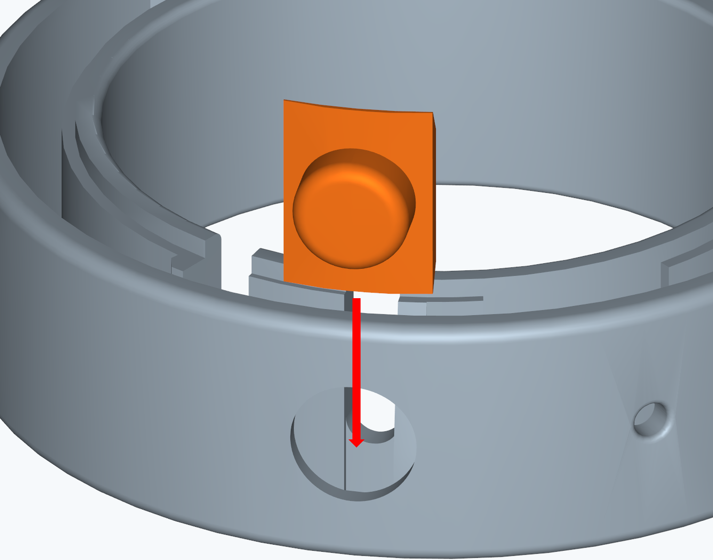
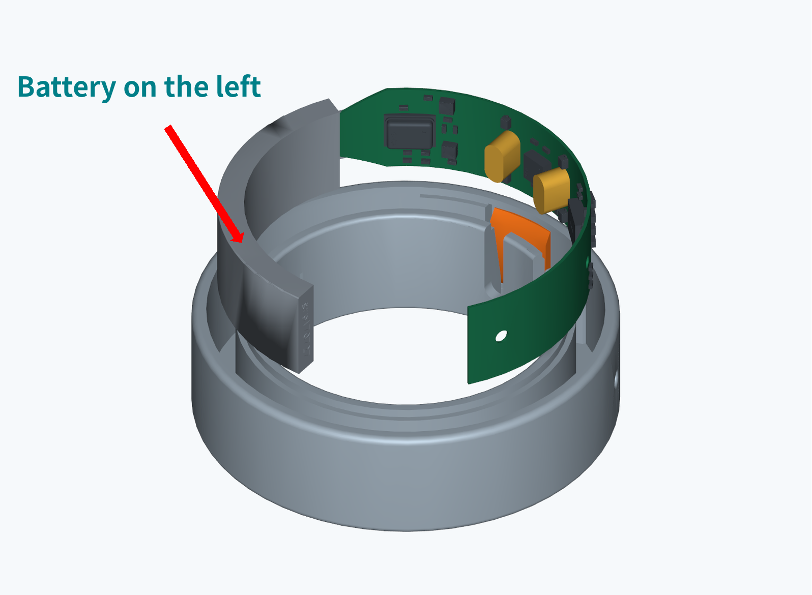
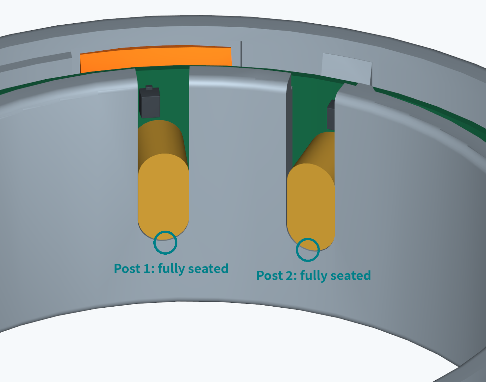
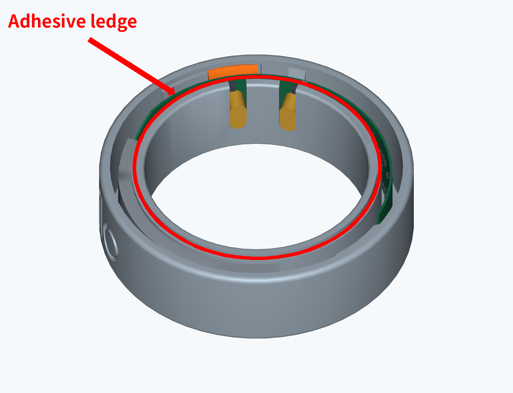
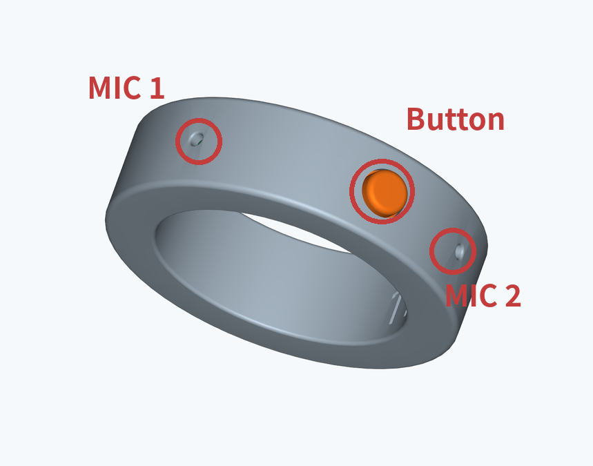

# OpenZilo Assembly Guide

[中文](assembly.md)

## 01 Parts Overview

- Cover
- Curved circuit board and battery assembly
- Button
- Ring housing

## 02 Vertical Button Installation

Do not lay the button flat

Keep the button upright

Hold the button by its edges. Lower it vertically, aligning it with the opening in the housing. Seat it gently without jamming.

Button seated

## 03 Circuit Board Installation: Battery on the Left

| Battery on the left | Align both posts with the U-shaped slots |
| --- | --- |
|  |  |
| Align, then lower into place | |

Use the orientation shown on the left, with the battery on the left-hand side.

Align both posts before slowly lowering the assembly.

If you feel resistance, stop and check. Do not force the assembly into place.

## 04 Post Seating and Component Protection

Post 1: fully seated

Post 2: fully seated

Both posts must reach the bottom of the U-shaped slots

Do not scrape the components

Circuit board positioning in the housing

Protect all components on the board. Avoid pressure and scraping.

Do not press on the components. If anything binds, stop and realign.

## 05 Button Operation Check

Press gently, then release

Check that the button moves smoothly and returns to its original position when released. It must not stick or sit at an angle.

If the button sticks, check the button and circuit board positions. Apply adhesive only after it moves freely.

Complete this check before applying adhesive

## 06 Adhesive Application

Adhesive ledge

Apply adhesive around the ledge at the top of the inner wall

Apply adhesive to the ledge. Instant adhesive or hot-melt adhesive may be used.

- MIC 1
- Button
- MIC 2

After applying adhesive, check that the button and both microphone ports are free of adhesive and blockages.

## 07 Cover Alignment and Installation

Align both tabs with the U-shaped notches

Align the cover with the ring opening. Check that no internal parts are trapped. Keep the cover aligned and press it gently into place.

## 08 Final Seating and Inspection

Press around the edge in stages

Check that the cover sits flush and the seam is even, with no raised edges, trapped parts or visible excess adhesive. Check the button again for smooth operation.
