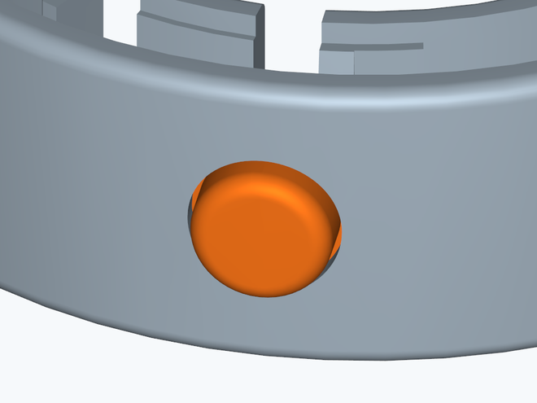
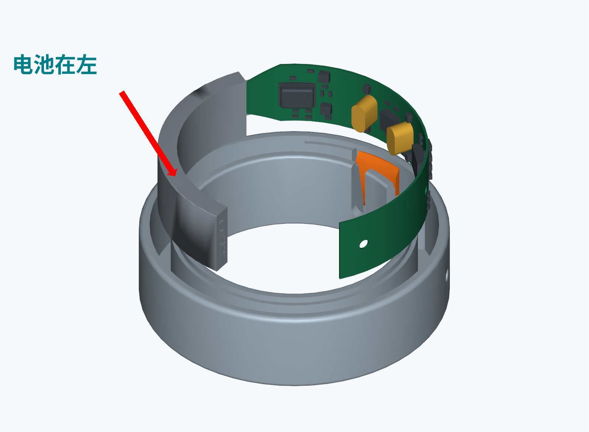
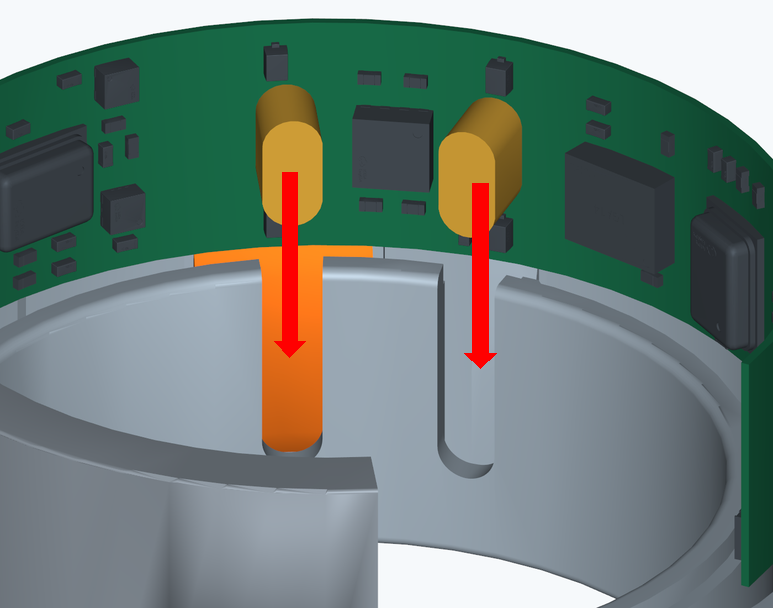
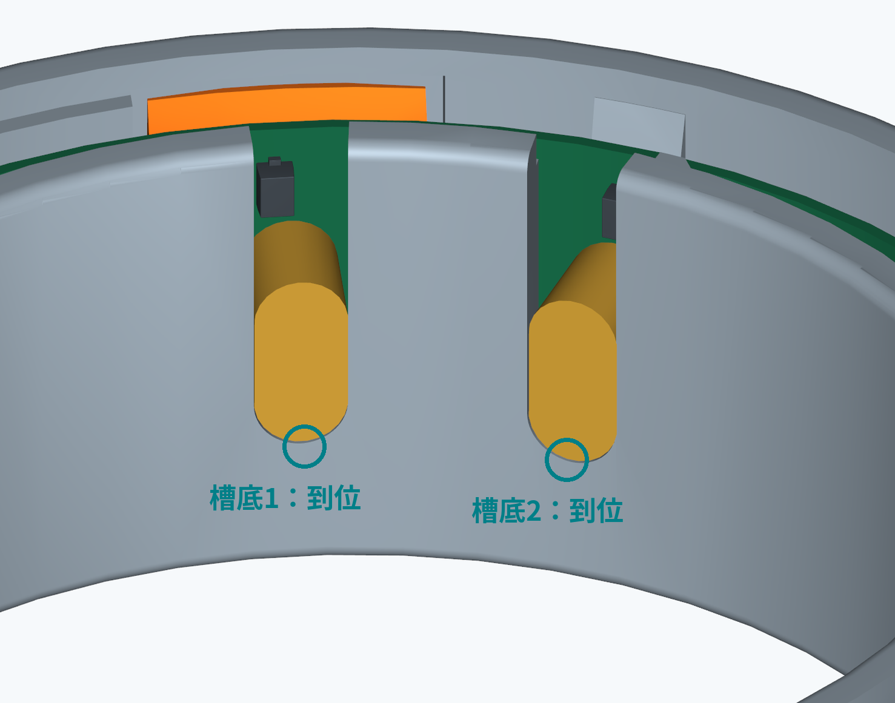
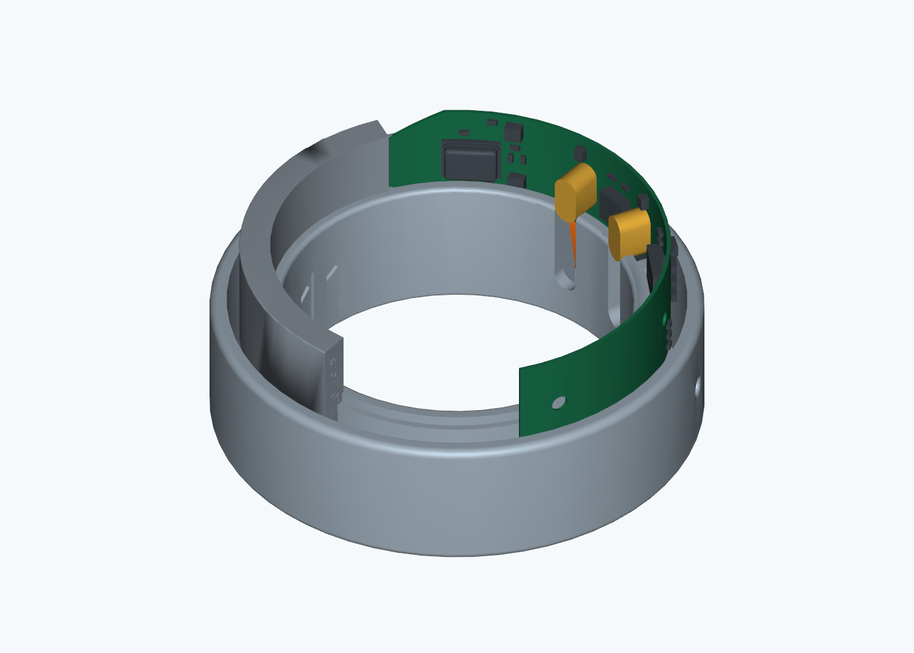
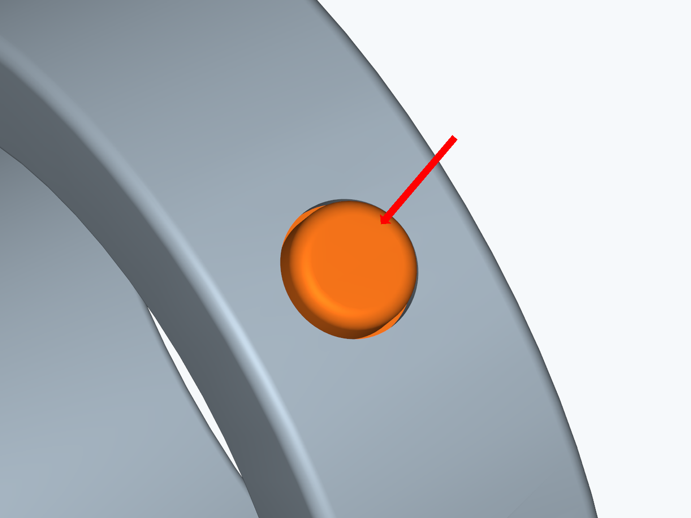
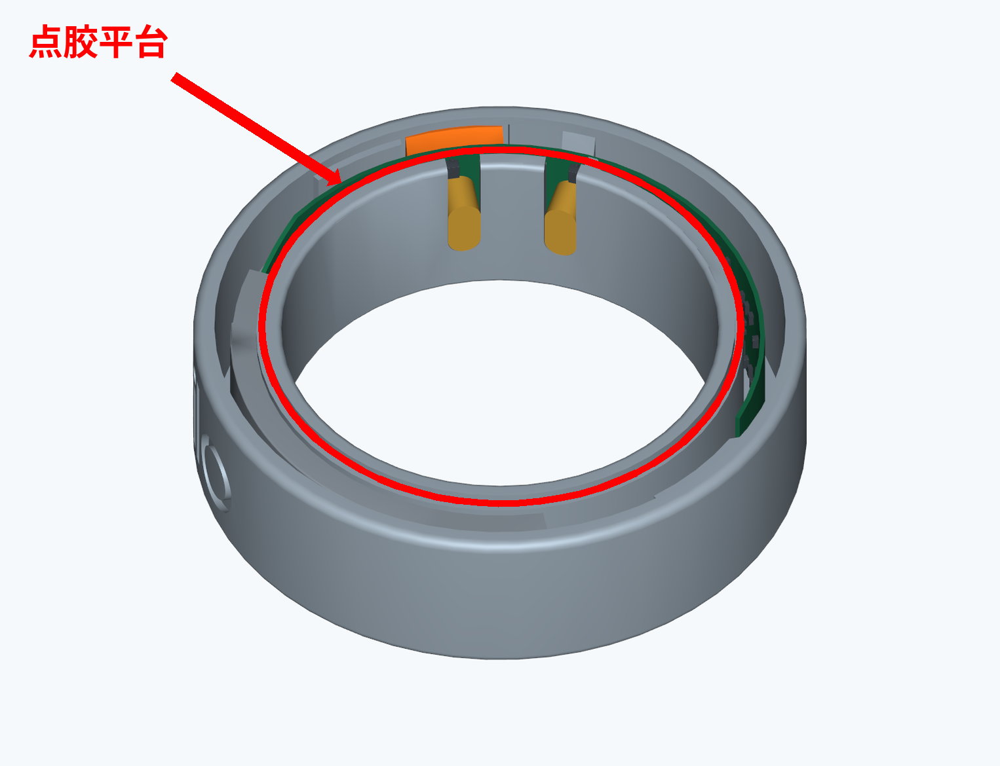
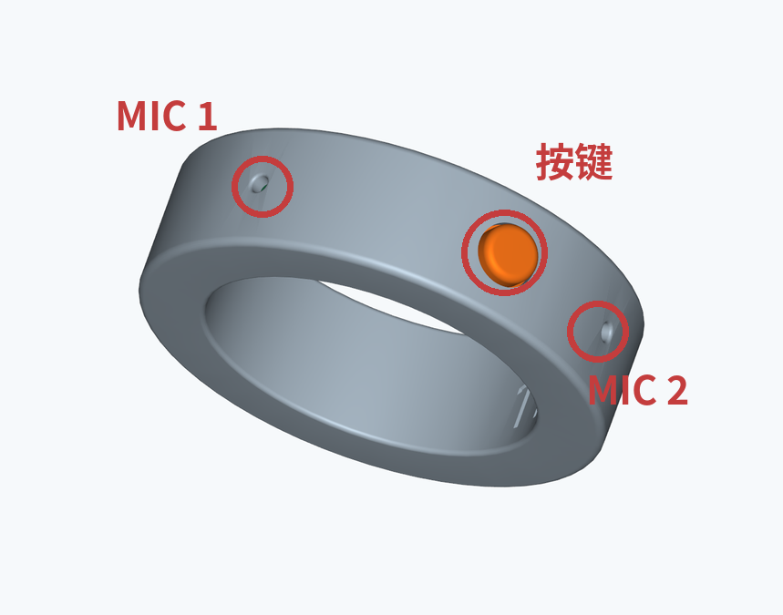
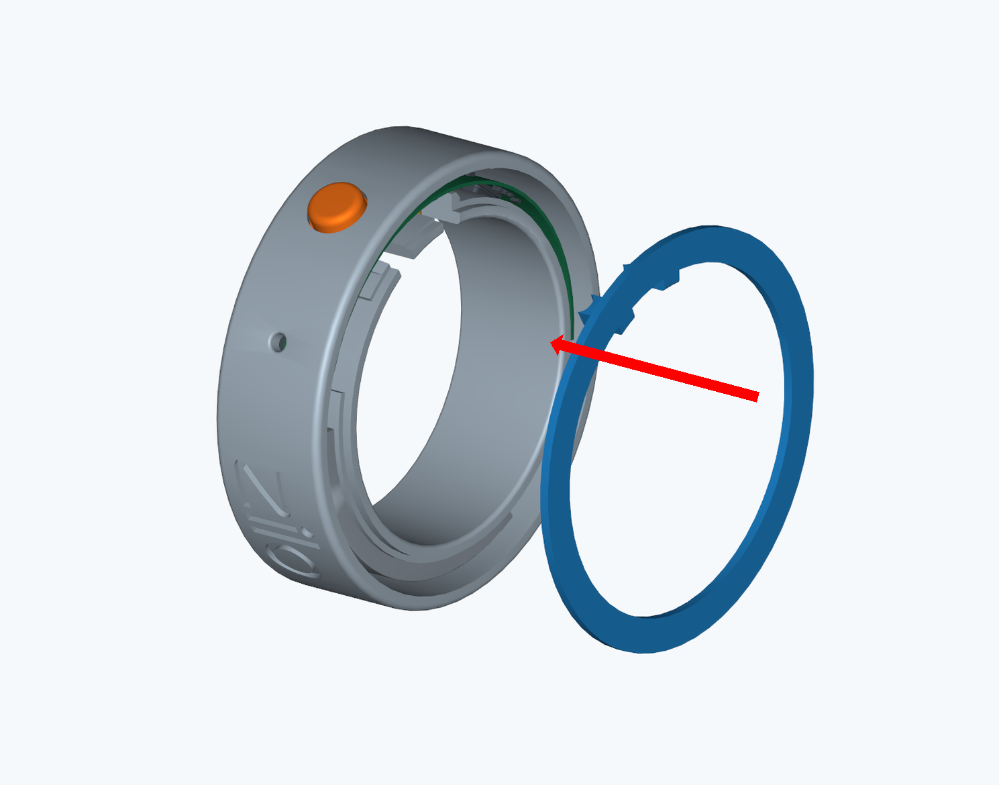

# OpenZilo组装示意

[English](assembly.en.md)

## 01 零件种类

- 上盖
- 弧形电路板与电池组件
- 按键
- 戒圈外壳

## 02 按键竖向装入

不得横放

按键保持竖直

夹持边缘，竖向下放按键对准外侧按键孔轻放就位，避免卡滞

装入后状态

## 03 电路板装入：电池在左

| 电池在左 | 两根立柱对准两个 U 型槽 |
| --- | --- |
|  |  |
| 对准后向下装入 | |

以左图方向为准，电池位于左侧。

两处同时对正，再缓慢装入。

遇阻先检查，禁止强行组装

## 04 立柱到底与器件防护

槽底1：到位

槽底2：到位

两根立柱都须装到 U 型槽底部

装入时不得剐蹭器件

外壳与电路板的装入关系

保护板上所有器件，避免挤压、剐蹭。

器件不得作为施力点卡阻时停止，重新对位

## 05 按键按压检查

轻按，松开后确认回弹

检查按压是否顺畅确认松开后能正常复位按键不得卡住或偏斜

有卡滞先检查按键和板子位置确认顺畅后，再进入点胶

此步在点胶前完成

## 06 外壳上方环形平台点胶

点胶平台

沿外壳内侧壁上方一圈平台点胶

点胶平台上点胶，可以采用瞬干胶或者热熔胶

- MIC 1
- 按键
- MIC 2

点胶后复查三处无进胶、无堵塞

## 07 上盖对位与合拢

两处凸脚与U形缺口对位

上盖对准戒圈敞口确认内部无夹件保持方向，轻压合拢

## 08 沿周压合与完成检查

沿周分段压合

上盖平齐，接缝均匀无翘边、夹件或明显溢胶复查按键活动顺畅
